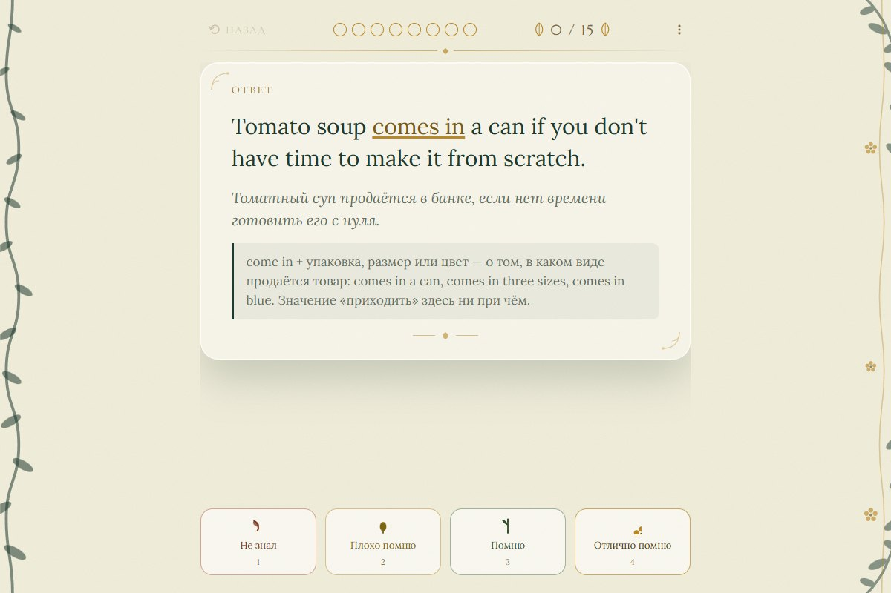

# Английские коллокации

Локальное приложение для интервального повторения английских коллокаций.
В колоде 1008 карточек: предложение с пропуском и переводом, подсказка,
раскрытие ответа и заметка об употреблении. Учащийся оценивает вспоминание
самостоятельно, а FSRS рассчитывает следующее повторение.

**React · TypeScript · Vite · IndexedDB · Python**



## Быстрый запуск

Нужны Node.js 22.12+ и npm. Для разработки и CI используется Node.js 24.

```sh
cd app
npm ci
npm start
```

Приложение откроется на **http://localhost:5173**. На Windows те же действия
выполняет двойной щелчок по `Коллокации.cmd`. В Chrome или Edge можно установить
сайт как приложение. После первой полной загрузки оно работает офлайн.
Для получения новых сборок нужен запущенный сервер.

## Занятия и данные

- По умолчанию: 15 новых карточек и до 120 обычных повторений за местные сутки.
  Недоученные карточки с коротким интервалом этим лимитом не ограничиваются.
- Пробел или Enter раскрывает ответ, затем ставит «Помню». Цифры 1–4 выбирают
  оценку, Backspace отменяет шаг, Escape завершает занятие. На кнопках и в меню
  действуют обычные правила клавиатуры.
- Прогресс хранится в профиле браузера. Обновление колоды сохраняет его по
  постоянным ID. Одновременно работает один экземпляр в пределах этого профиля.
- Меню «Копия и хранилище» сохраняет полный файл `.json.gz` и восстанавливает
  более свежие данные из копии. Поддерживаются форматы 1–3.
  Восстановление доступно также при ошибке запуска.
- В том же меню пункт «Убранные карточки» позволяет найти приостановленную
  карточку и вернуть её в обучение с сохранением расписания и истории.
- При восстановлении принимаются файлы до 32 МиБ и JSON до 64 МиБ после распаковки.
- Перед переносом на другое устройство или очисткой браузера сохраните копию.

Рабочая версия использует порт **5173**, разработка — **5174**.
Это разные источники с разными базами. Смена браузера, профиля, имени хоста или
порта также открывает отдельное хранилище.

## Разработка и проверки

```sh
cd app
npm run dev           # http://localhost:5174
npm run check         # формат, типы, тесты приложения и сборочных скриптов
npm run build         # production-сборка с офлайн-кэшем
npm run preview       # просмотр dist на 5173
npm run format        # привести файлы к принятому стилю
```

Для проверок пайплайна достаточно Python 3.11+:

```sh
python -m pip install -r pipeline/requirements-check.txt
python -m pipeline.check
```

Проверки работают с готовой колодой без скачанного сырья.
Те же команды выполняются в GitHub Actions при push и pull request.

## Структура

| Каталог                                | Содержимое                                               |
| -------------------------------------- | -------------------------------------------------------- |
| [`app`](app/README.md)                 | PWA, планировщик, хранилище, занятия и интерфейс         |
| [`pipeline`](pipeline/README.md)       | Получение, нормализация, ранжирование и сборка материала |
| `decks`                                | Опубликованные манифесты и части с контрольными суммами  |
| `schema`                               | Формат колоды и реестр постоянных ID                     |
| `translations`, `notes`, `sentences`   | Ручные переводы, пояснения и исправления примеров        |
| [`docs/design`](docs/design/README.md) | Исходные макеты интерфейса                               |
| `docs/archive`                         | Исторический план разработки                             |

Прогресс пользователей, зависимости, сборки и сырьё не входят в Git.
Правила внесения изменений — в [CONTRIBUTING.md](CONTRIBUTING.md).

## Границы текущей версии

Сервера учётных записей и синхронизации между устройствами нет. Перенос данных
выполняется резервной копией. ID карточек глобальны: колоды с пересекающимися ID
нельзя хранить одновременно; конфликтующий импорт отклоняется до изменения базы.

Источник материала — словарные статьи ozdic; происхождение записано в манифесте.
Заметки и переводы проверяются отдельно от кода. Остальные партнёры словарного
кластера показаны для изучения: их смысл и форма зависят от контекста.
